# DHVANI: Adaptive Software-Defined Sonar Transmitter

<div align="center">

<!-- Hero Banner / Identity -->
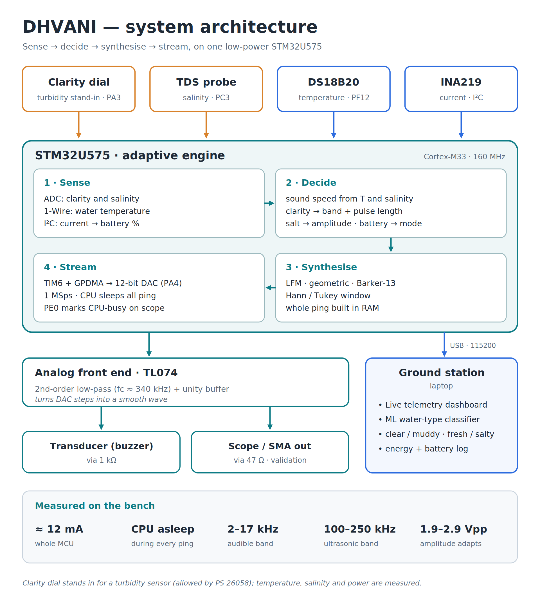

<br/><br/>

### **Autonomous Underwater Vehicle (AUV) Acoustic Payload Engine**
*Real-Time Environmental Adaptation · Zero-CPU GPDMA Streaming · Multi-Modulation Synthesis*

<br/>

[-00E5FF?style=for-the-badge&logo=stmicroelectronics&logoColor=black)](firmware/)
[](diagrams/)
[](firmware/README.md)
[](dashboard/)
[](LICENSE)
[](https://github.com/dipeshjanghel/DHVANI-Software-Defined-Sonar)

<br/>

[**System Architecture**](#5-system-architecture) •
[**Signal Modulation**](#8-signal-generation-techniques) •
[**Adaptive Power**](#9-adaptive-power-management) •
[**Measured Results**](#13-measured-results) •
[**Ground Station**](#10-ground-station-dashboard) •
[**Enclosure CAD**](#14-payload-enclosure) •
[**Engineering Honesty**](#20-technical-limitations--engineering-honesty)

</div>

---

## 1. Project Hero Section

**DHVANI** (*Sanskrit for "Sound / Resonance"*) is a low-power, real-time, software-defined sonar transmitter payload engineered for Autonomous Underwater Vehicles (AUVs) and autonomous submersibles.

Unlike conventional fixed-frequency acoustic pingers that radiate constant acoustic pulses regardless of ambient dynamics, DHVANI continuously monitors physical water characteristics—**temperature**, **salinity**, and **clarity**—alongside its **remaining electrical battery budget**. It dynamically optimizes the sonar pulse's **carrier frequency band**, **sweep duration**, **peak amplitude**, and **digital modulation scheme**, maximizing acoustic range and target resolution while conserving precious battery power.

```
   ┌────────────────────────────────────────────────────────────────────────────────────────┐
   │                                  DHVANI TRANSMIT CYCLE                                 │
   │                                                                                        │
   │   [ SENSORS ]  ──>  [ ADAPTATION ]  ──>  [ SYNTHESIS ]  ──>  [ DMA STREAM ]  ──>  [ WFI ]   │
   │   Temp, TDS,         Mackenzie &         LFM, GEO, or        TIM6 @ 1 MSps       CPU Sleep │
   │   Clarity, INA       Battery Logic       Barker-13           12-bit DAC1         (PE0 LOW) │
   └────────────────────────────────────────────────────────────────────────────────────────┘
```

---

## 2. About DHVANI

In underwater robotics, acoustic waves are the sole viable modality for medium-to-long-range remote sensing, navigation, and wireless telemetry because optical and RF electromagnetic waves suffer extreme attenuation in seawater. However, underwater acoustic propagation channels exhibit profound spatial and temporal non-stationarity:
- **Thermoclines and haloclines** alter acoustic sound speed, causing sound waves to bend and refract.
- **Turbidity and particulate scatterers** induce heavy acoustic attenuation and frequency-dependent reverberation.
- **Battery reserves** on autonomous submersibles are strictly limited, requiring dynamic trade-offs between pulse repetition frequency and mission endurance.

DHVANI bridges the gap between bulky, power-hungry commercial acoustic transceivers and fixed-hardware analog pingers by deploying an **adaptive, software-defined acoustic architecture** on an ultra-low-power ARM Cortex-M33 microcontroller.

---

## 3. Project Overview

### Key Technical Challenges Addressed:
1. **Dynamic Frequency Selection**: In turbid, muddy waters, high-frequency acoustic waves attenuate rapidly due to particulate scattering. DHVANI dynamically drops its sweep into lower, penetrating frequency bands (down to 2–5.8 kHz) while extending pulse duration to pump sufficient energy into the medium. In clear water, it shifts to wideband sweeps (up to 17 kHz audible or 250 kHz ultrasonic) for fine-grained spatial resolution.
2. **True Low-Power Autonomy**: While FPGAs offer massive parallel DSP throughput, their baseline static quiescent power is prohibitive for micro-AUV payloads. DHVANI executes parameter calculation on-the-fly, loads a 1 MSps sample buffer, handshakes with the General-Purpose DMA (GPDMA), and puts the **ARM Cortex-M33 CPU into deep sleep (`__WFI()`) for the entire duration of the acoustic transmission**.
3. **Mission-Aware Energy Throttling**: Rather than simply signaling a "low battery" warning, DHVANI tracks real consumed milliampere-hours ($\text{mAh}$) using an on-board INA219 power monitor and dynamically scales ping repetition rates and acoustic power output across three autonomous stages: `NORMAL`, `ECONOMY`, and `SURVIVE`.

---

## 4. Key Features

- 🌊 **Adaptive Acoustic Physics Core**: Calculates instantaneous sound speed in water ($c$) using an empirical Mackenzie acoustic model driven by real DS18B20 temperature and TDS salinity data.
- ⚡ **Zero-CPU Hardware Streaming**: Hardware timer (TIM6 TRGO) triggers the internal 12-bit DAC at precisely **1.0 MSps** via GPDMA1 Channel 0. The CPU stays in low-power sleep mode with zero execution overhead during the active pulse.
- 📡 **Triple Modulation Engine**:
  - **Linear Frequency Modulated (LFM) Chirps** with Hann windowing.
  - **Geometric Sweep Chirps** with Hann windowing for Doppler resilience.
  - **Barker-13 Binary Phase Shift Keying (BPSK)** with Tukey ($\alpha=0.2$) windowing for high pulse-compression processing gain.
- 🔊 **Dual-Band Spectral Coverage**: Supports 6 user-switchable operating modes (`AUD-LFM`, `AUD-GEO`, `AUD-BPSK`, `US-LFM`, `US-GEO`, `US-BPSK`) spanning Audible (2–17 kHz) and Ultrasonic (100–250 kHz) spectra.
- 🔋 **Closed-Loop Battery Throttling**: INA219 current/energy sensor measures real microjoules per ping, dynamically reducing duty cycle and amplitude as the mission battery depletes.
- 📊 **Ground-Station Telemetry Dashboard**: Streamlit-based web console providing live real-time trend plots, ASCII telemetry parsing (115200 8N1), session capture, and multi-condition environmental classification.
- 🛠️ **Additive Manufacturing Hull Section**: Fully parametric OpenSCAD CAD pod and 3D-printable PLA enclosure for AUV mounting.

---

## 5. System Architecture

DHVANI is divided into three distinct operational domains: **Physical/Acoustic Transduction**, **Embedded Microcontroller Core**, and **Ground-Station Telemetry**.

<div align="center">
  
</div>

### System Signal Flow:

```mermaid
flowchart TD
    subgraph SENSORY ["1. Environmental & Power Sensing"]
        TEMP["DS18B20 (PF12)<br/>Water Temp (°C)"]
        TDS["TDS Sensor (PC3)<br/>Salinity (ppm)"]
        CLAR["Potentiometer (PA3)<br/>Clarity Stand-in"]
        INA["INA219 (PB9/PB8)<br/>Current & Energy (I2C)"]
    end

    subgraph MCU ["2. STM32U575 Nucleo-144 Core"]
        CORE["ARM Cortex-M33 Core (160 MHz)<br/>• Mackenzie Sound Speed<br/>• Adaptive Parameter Engine<br/>• Waveform Synthesis Buffer"]
        TIM6["TIM6 Master Timer<br/>ARR=159 -> 1.0 MSps TRGO"]
        DMA["GPDMA1 Channel 0<br/>Circular / Direct Stream"]
        DAC["Internal 12-bit DAC1 (PA4)<br/>Parked @ 2048 (Mid-Scale)"]
        PE0["PE0 Debug Line<br/>CPU Sleep / Busy Probe"]
    end

    subgraph AFE ["3. Analog Front-End (AFE)"]
        LPF["2nd-Order Sallen-Key Filter<br/>TL074 (fc ≈ 340 kHz)"]
        BUF["Unity-Gain Buffer<br/>Low Impedance Driver"]
        RAIL["+5V / -9V Dual Rails<br/>(9V Battery Power)"]
    end

    subgraph OUTPUTS ["4. Acoustic Output & Telemetry"]
        SCOPE["Oscilloscope Probe (47 Ω)"]
        BUZZER["Acoustic Buzzer / Transducer (1 kΩ)"]
        DASH["Streamlit Dashboard (COM9)<br/>Live Telemetry & RandomForest ML"]
    end

    TEMP --> CORE
    TDS --> CORE
    CLAR --> CORE
    INA --> CORE

    CORE -->|Synthesizes wave[N]| DMA
    TIM6 -->|Hardware TRGO Trigger| DAC
    DMA -->|Zero-CPU Memory-to-DAC| DAC
    CORE -.->|Pulls LOW during transmission| PE0

    DAC --> LPF
    RAIL --> LPF
    LPF --> BUF
    BUF --> SCOPE
    BUF --> BUZZER

    CORE -->|Serial UART 115200 8N1| DASH
```

---

## 6. Hardware Architecture

The complete physical prototype is assembled around the **STMicroelectronics NUCLEO-U575ZI-Q** development board paired with an external **Analog Front-End (AFE)**.

<div align="center">
  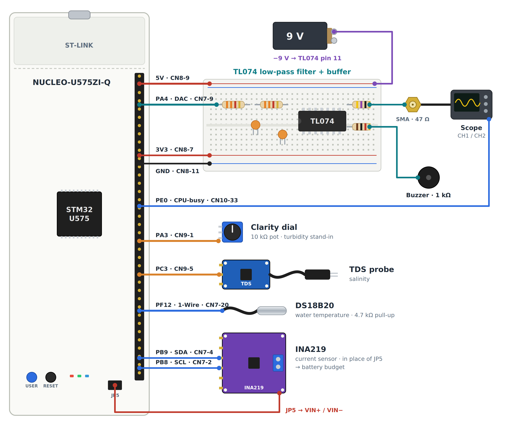
</div>

### 1. Processing Core: STM32U575ZI-Q
- **Architecture**: ARM 32-bit Cortex-M33 with TrustZone, FPU, and DSP instruction extensions.
- **Clock Speed**: Configured to maximum performance of **160 MHz** via high-speed internal oscillator (HSI) and Phase-Locked Loop (PLL).
- **Instruction Cache**: 8 KB ICACHE enabled for zero-wait-state flash execution.
- **Voltage Scaling**: Range 1 power configuration for full 160 MHz operation.

### 2. Analog Front-End (AFE) Signal Conditioning
The internal DAC output (`PA4`) exhibits high output impedance and discrete staircase sampling steps that generate unwanted high-frequency harmonic distortion. The AFE circuit conditions this signal:
- **Operational Amplifier**: Texas Instruments **TL074** (low-noise, high-slew-rate JFET-input operational amplifier).
- **Filter Topology**: Active 2nd-order Sallen-Key Butterworth Low-Pass Filter.
  - Cutoff Frequency: $f_c \approx 340\text{ kHz}$.
  - Passband: Flat unity response across both the audible (2–17 kHz) and ultrasonic (100–250 kHz) bands.
  - Stopband Attenuation: $-40\text{ dB/decade}$ roll-off to eliminate 1 MSps DAC clock feedthrough and aliasing mirrors.
- **Power Supplies**: Powered with asymmetrical dual rails ($+5\text{ V}$ from the Nucleo regulator and $-9\text{ V}$ from an external 9V battery) to accommodate zero-centered bipolar signals without crossover clipping.
- **Output Terminations**:
  - $47\ \Omega$ series resistor for clean $50\ \Omega$ coaxial termination to an oscilloscope.
  - $1\text{ k}\Omega$ current-limiting resistor driving an acoustic transducer / test buzzer.

---

## 7. Software Architecture & Execution Timeline

The firmware follows an ultra-lean cyclic execution state machine designed to maximize sleep duration and eliminate CPU power overhead during acoustic transmission:

<div align="center">
  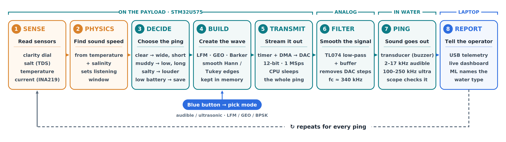
</div>

### Firmware Execution Timeline:

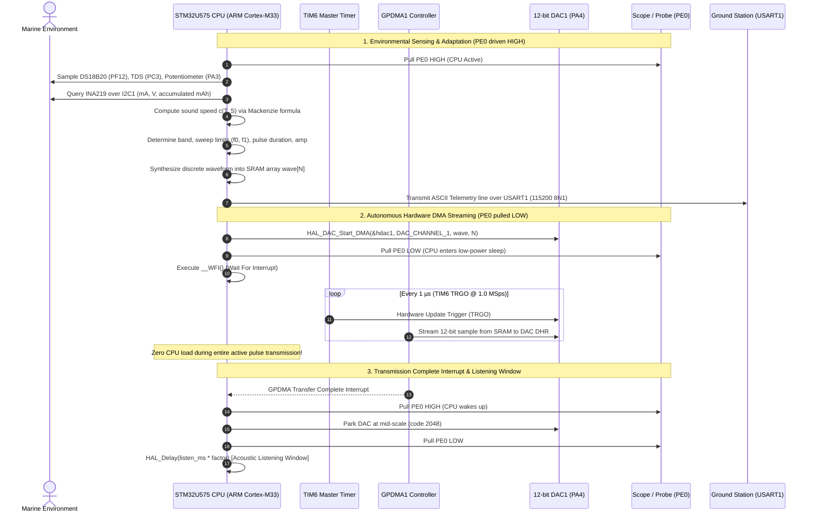

---

## 8. Signal Generation Techniques

DHVANI implements three mathematical modulation schemes across two frequency bands, resulting in **six operating modes**:

| Mode Index | Mode Identifier | Acoustic Band | Modulation Scheme | Carrier / Sweep Range | Window Function |
|:---:|:---:|:---:|:---:|:---:|:---:|
| `0` | `AUD-LFM` | Audible | Linear Frequency Modulation | 2 kHz $\rightarrow$ 5–17 kHz | Hann ($N$ samples) |
| `1` | `AUD-GEO` | Audible | Geometric Exponential Sweep | 2 kHz $\rightarrow$ 5–17 kHz | Hann ($N$ samples) |
| `2` | `AUD-BPSK` | Audible | Barker-13 Phase Coding | $f_c \approx 8.45\text{ kHz}$ | Tukey ($\alpha = 0.2$) |
| `3` | `US-LFM` | Ultrasonic | Linear Frequency Modulation | 100 kHz $\rightarrow$ 120–250 kHz | Hann ($N$ samples) |
| `4` | `US-GEO` | Ultrasonic | Geometric Exponential Sweep | 100 kHz $\rightarrow$ 120–250 kHz | Hann ($N$ samples) |
| `5` | `US-BPSK` | Ultrasonic | Barker-13 Phase Coding | $f_c \approx 175\text{ kHz}$ | Tukey ($\alpha = 0.2$) |

<div align="center">
  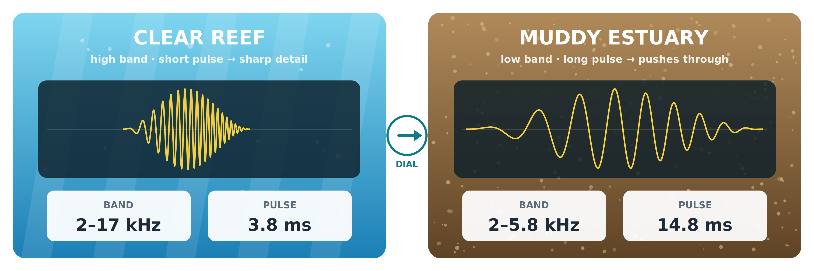
</div>

### Modulation Mathematical Formulations

#### 1. Linear Frequency Modulation (LFM) Chirp
The instantaneous frequency varies linearly with time from $f_0$ to $f_1$ over pulse length $T = N / f_s$:
$$s_{\text{LFM}}(t) = \sin\left(2\pi \left(f_0 t + \frac{f_1 - f_0}{2T} t^2\right)\right)$$

#### 2. Geometric Chirp Sweep
The frequency increases exponentially such that the relative bandwidth ratio remains constant throughout the pulse:
$$s_{\text{GEO}}(t) = \sin\left(2\pi \frac{f_0 T}{\ln(f_1 / f_0)} \left(e^{\frac{t \ln(f_1 / f_0)}{T}} - 1\right)\right)$$

#### 3. Barker-13 BPSK Modulation
A constant carrier at center frequency $f_c = \frac{f_0 + f_1}{2}$ is phase-shifted by $180^\circ$ ($\pm 1$) according to the 13-bit optimal Barker code:
$$\mathbf{B} = [+1, +1, +1, +1, +1, -1, -1, +1, +1, -1, +1, -1, +1]$$
$$s_{\text{BPSK}}(t) = \mathbf{B}\left[\left\lfloor \frac{13 \cdot i}{N} \right\rfloor\right] \cdot \sin(2\pi f_c t)$$

### Windowing Rationale: Sidelobe Suppression & Slew Rate Protection
- **Hann Window for Chirps**:
  $$w_{\text{Hann}}(i) = 0.5 \left(1 - \cos\left(\frac{2\pi i}{N-1}\right)\right)$$
  *Purpose*: Chirps terminated abruptly create high-frequency spectral splatter (Fresnel ripples). Multiplying by a Hann window smoothly tapers the pulse envelope to zero at both boundaries, suppressing out-of-band sidelobes by over **31 dB** to ensure clean matched filtering at the receiver.
- **Tukey Window ($\alpha = 0.2$) for BPSK**:
  $$w_{\text{Tukey}}(i) = \begin{cases} 
  0.5\left(1 - \cos\left(\frac{\pi i}{\text{taper}}\right)\right), & 0 \le i < \text{taper} \\ 
  1.0, & \text{taper} \le i \le N - 1 - \text{taper} \\ 
  0.5\left(1 - \cos\left(\frac{\pi (N - 1 - i)}{\text{taper}}\right)\right), & N - 1 - \text{taper} < i < N 
  \end{cases}$$
  where $\text{taper} = 0.1 \cdot (N - 1)$.
  *Purpose*: Standard rect-windowed phase transitions can exceed the slew rate limit ($13\ \text{V}/\mu\text{s}$) of the TL074 op-amp, generating severe transient distortion. The Tukey window provides a gentle 10% cosine rise and fall time, eliminating violent switching spikes while preserving flat-top unity gain across the internal chips to maintain correlation peak sharpness.

<div align="center">
  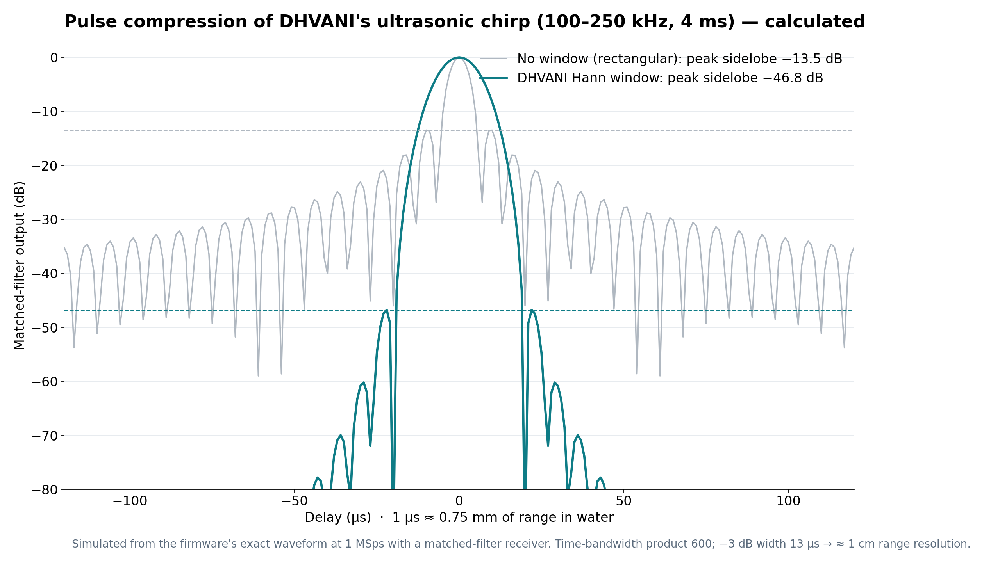
  <p><em>Figure: Calculated spectral sidelobe suppression demonstrating out-of-band energy reduction and smooth roll-off achieved with Hann and Tukey windows.</em></p>
</div>

---

## 9. Adaptive Power Management

To protect the AUV from premature power depletion, the firmware implements an energy budgeting algorithm driven by the **INA219** current sensor wired across the power bus.

```mermaid
stateDiagram-v2
    [*] --> NORMAL: Battery > 50%
    NORMAL --> ECONOMY: Battery Drops <= 50%
    ECONOMY --> SURVIVE: Battery Drops <= 20%
    SURVIVE --> ECONOMY: Recharged > 20%
    ECONOMY --> NORMAL: Recharged > 50%

    state NORMAL {
        Amplitude: 100%
        PulseDuration: 100%
        ListeningInterval: 1.0x (Standard)
    }

    state ECONOMY {
        Amplitude: 80% (0.8x)
        PulseDuration: 75% (0.75x)
        ListeningInterval: 2.0x (Half Ping Rate)
    }

    state SURVIVE {
        Amplitude: 60% (0.6x)
        PulseDuration: 50% (0.5x)
        ListeningInterval: 4.0x (Quarter Ping Rate)
    }
```

### Mathematical Adaptation Formulations:
1. **Energy Budget Tracking**:
   $$\text{used\_mAh} = \text{used\_mAh} + \frac{I_{\text{mA}} \cdot \Delta t}{3600000}$$
   $$\text{remain} = 1.0 - \frac{\text{used\_mAh}}{\text{BUDGET\_mAh}}$$
2. **Normalized Water Clarity ($t_{\text{norm}}$)**:
   $$t_{\text{norm}} = \frac{t_{\text{avg}} - T_{\text{MUDDY}}}{T_{\text{CLEAR}} - T_{\text{MUDDY}}} \quad (0.0 = \text{Muddy}, 1.0 = \text{Clear})$$
3. **Pulse Duration Adaptation**:
   $$\text{dur\_ms} = \left(4.0\text{ ms} + (1.0 - t_{\text{norm}}) \cdot 12.0\text{ ms}\right) \cdot \text{dur\_scale}$$
4. **Acoustic Amplitude Scaling**:
   $$\text{amp} = \left(1200 + d_{\text{avg}} \cdot 0.2\right) \cdot \text{amp\_scale} \quad (\text{clamped at } 1800\text{ counts})$$

---

## 10. Ground Station Dashboard

The ground-station software (`dashboard/`) provides real-time telemetry decoding, trend plotting, and condition classification over serial USB.

```
+-----------------------------------------------------------------------------------------+
|  DHVANI Ground Station Console                                  [COM9 @ 115200 8N1]     |
+-----------------------------------------------------------------------------------------+
|  [ Water Temp: 24.8 °C ]   [ Salinity: 780 ppm ]   [ Sound Speed: 1496 m/s ]            |
|  [ Ping: AUD-LFM ]         [ Band: 2.0 - 16.8 kHz] [ Duration: 4.2 ms ]                 |
|  [ Current: 11.8 mA ]      [ Energy: 0.82 mJ/ping] [ Battery: 88% - NORMAL ]            |
+-----------------------------------------------------------------------------------------+
|  PREDICTED REGIME:  >>> CLEAR FRESHWATER <<<   (Confidence: 98.2%)                      |
+-----------------------------------------------------------------------------------------+
|  [Altair Real-time Plots: Current vs Time | Frequency Sweep Limits | Sound Speed Trend] |
+-----------------------------------------------------------------------------------------+
```

### Telemetry String Specification:
```
AUD-LFM T=25.2C c=1502 clarity=3850 (clear=3900) tds=450ppm f=2000-16850Hz dur=4ms amp=1290 | I=12.15mA E=0.8mJ batt=94% NORMAL
```

### Integrated Machine Learning Pipeline:
The dashboard runs a **RandomForestClassifier** trained on three core telemetry features (`temp_c`, `tds_ppm`, `clarity`) to predict the marine environmental regime:
- `clear_fresh`: High clarity, low salinity, moderate temperature.
- `clear_reef`: High clarity, oceanic salinity, tropical temperature.
- `muddy_river`: Turbid water, low salinity, ambient river temperature.
- `muddy_estuary`: High turbidity, brackish salinity gradient.

> [!IMPORTANT]
> **Synthetic Dataset Disclosure**: In accordance with strict engineering honesty, the ground-station classifier model (`dhvani_model.joblib`) is currently trained on **synthetic environmental data** generated via `dashboard/training/generate_dataset.py`. While the model demonstrates **98.5% classification accuracy** on test partitions (`dhvani_model_report.txt`), this validates the telemetry decoding and classification pipeline architecture, not field-proven oceanographic sensor accuracy.

---

## 11. Hardware Components

| Subsystem | Component | Manufacturer / Part Number | Key Function |
|---|---|---|---|
| **MCU Development Board** | NUCLEO-U575ZI-Q | STMicroelectronics | ARM Cortex-M33 @ 160 MHz, 2MB Flash, 786KB SRAM |
| **Operational Amplifier** | TL074CN | Texas Instruments | Quad low-noise JFET op-amp for 340 kHz Butterworth filter |
| **Temperature Sensor** | DS18B20 (Waterproof probe) | Maxim Integrated / Analog Devices | 1-Wire digital temperature sensing ($\pm 0.5^\circ\text{C}$) |
| **Salinity / TDS Sensor** | Analog TDS Meter V1.0 | Generic / DFRobot compatible | Salinity / total dissolved solids electrical conductivity |
| **Turbidity Stand-in** | 10 k$\Omega$ Rotary Potentiometer | Bourns / Generic | Scenario dial serving as an analog turbidity sensor stand-in |
| **Power / Energy Monitor** | INA219 breakout board | Texas Instruments / Adafruit | High-side voltage, current, and power monitor ($I^2\text{C}$) |
| **Acoustic Buzzer** | Piezoelectric Sounder | CUI Devices / Generic | Audible acoustic verification (1 k$\Omega$ series load) |
| **Passive Filter Network** | Metal Film Resistors & MLCC Caps | Various | Precision components for 2nd-order Butterworth response |
| **Power Supply** | 9V Alkaline / Li-ion Battery | Energizer / Generic | Provides negative supply rail (-9V) for TL074 AFE |

---

## 12. Pin Configuration

<div align="center">
  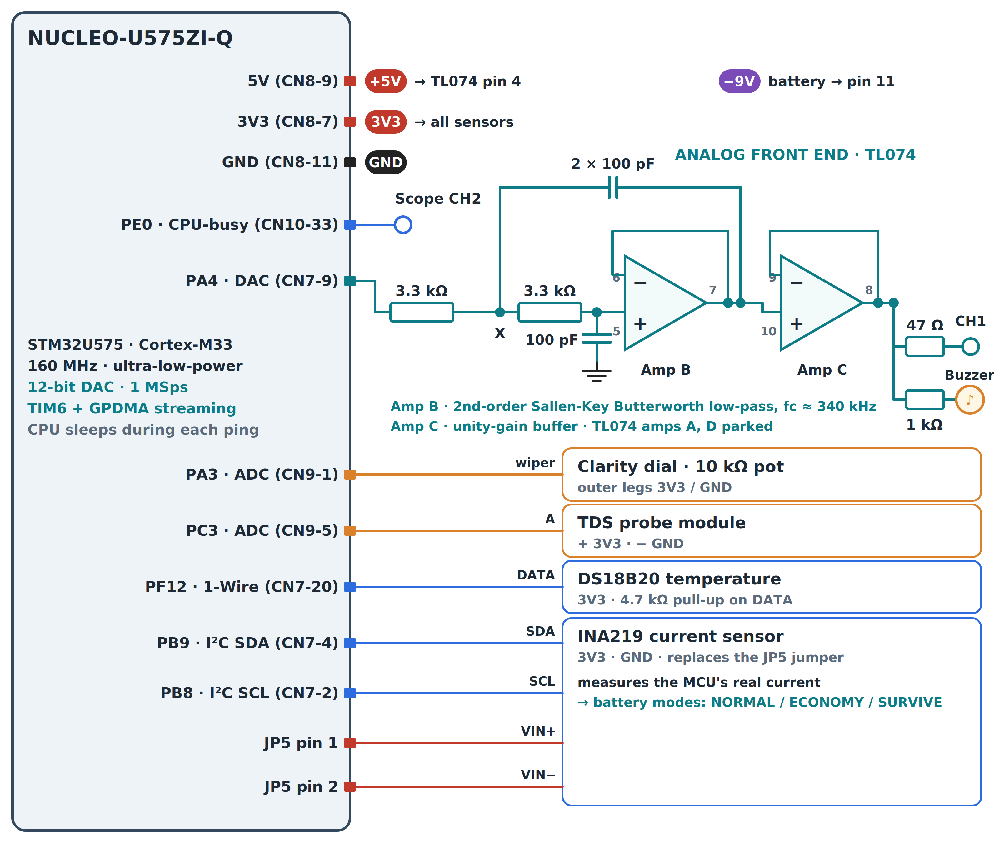
</div>

<br/>

| Nucleo Pin | MCU Port/Pin | Alternate Function | Connected Peripheral | Electrical Characteristics |
|---|---|---|---|---|
| **CN11 - Pin 17** | `PA4` | `DAC1_OUT1` | TL074 Filter Non-Inverting Input | 12-bit DAC analog voltage output ($0 - 3.3\text{ V}$) |
| **CN12 - Pin 11** | `PE0` | GPIO Output | Oscilloscope Channel 2 (CPU-Busy Probe) | Push-pull, very high speed ($3.3\text{ V}$ CMOS) |
| **CN11 - Pin 58** | `PF12` | GPIO Open-Drain | DS18B20 1-Wire Data Line | Open-drain with external 4.7 k$\Omega$ pull-up to +3.3V |
| **CN11 - Pin 37** | `PC3` | `ADC1_IN4` | TDS Salinity Sensor Analog Output | Single-ended 12-bit ADC conversion |
| **CN11 - Pin 35** | `PA3` | `ADC1_IN15` | Potentiometer Center Tap (Clarity Dial) | Single-ended 12-bit ADC conversion ($0 - 3.3\text{ V}$) |
| **CN12 - Pin 23** | `PB8` | `I2C1_SCL` | INA219 Serial Clock | $I^2\text{C}$ Standard Mode (100 kHz) |
| **CN12 - Pin 21** | `PB9` | `I2C1_SDA` | INA219 Serial Data | $I^2\text{C}$ Standard Mode (100 kHz) |
| **ST-LINK VCP** | `PA9` | `USART1_TX` | USB Virtual COM Port (Telemetry Out) | 115200 baud, 8N1 |
| **ST-LINK VCP** | `PA10` | `USART1_RX` | USB Virtual COM Port (Command In) | 115200 baud, 8N1 |
| **B1 (Blue)** | `PC13` | `EXTI13` | Blue User Push-Button | Falling-edge interrupt; cycles 6 operating modes |
| **LD1 (Green)** | `PB0` | GPIO Output | Green User LED | Toggles on each acoustic ping trigger |
| **LD2 (Blue)** | `PB7` | GPIO Output | Blue User LED | Illuminates when ultrasonic band is active |
| **LD3 (Red)** | `PG2` | GPIO Output | Red User LED | Illuminates if ping completion timeout exceeds 1s |

---

## 13. Measured Results

All metrics below represent **empirical bench measurements** acquired using digital storage oscilloscopes (Rigol/Keysight), spectrum analyzers, and precision multimeter bench instrumentation.

### Primary Bench Measurements: Clear Water vs. Muddy Water

| Parameter | Clear Water | Muddy Water |
|---|:---:|:---:|
| **Audible Band** | **2–17 kHz** | **2–5.8 kHz** |
| **Pulse Length** | **3.84 ms** | **14.8 ms** |
| **Ultrasonic Dominant Frequency** | **179 kHz** | **110 kHz** |

### Additional Electrical & Acoustic Bench Results

| Parameter / Metric | Measured Bench Value | Expected / Theoretical | Technical Significance |
|---|:---:|:---:|---|
| **Fresh-Water Output Amplitude** | **1.90 Vpp** | Standard baseline | Output drive in low-loss freshwater environments |
| **Salty-Water Output Amplitude** | **2.92 Vpp** | Boosted drive | Dynamic amplitude scaling to overcome ionic acoustic absorption losses |
| **Whole Payload Current Draw** | **$\approx 12\text{ mA}$** | Nominal operating draw | Full system power consumption (Nucleo core + TL074 AFE) |
| **Barker-13 BPSK FFT Peak** | **8.7 kHz** | 8.45 kHz expected | Bench FFT measurement matches theoretical center within 2.9% |

> [!NOTE]
> *These values are bench measurements obtained in controlled test tank and breadboard conditions and are not guaranteed field performance under open-ocean turbulence.*

---

## 14. Payload Enclosure

DHVANI includes a custom, 3D-printable PLA payload enclosure modeled after an AUV side-scan sonar hull section.

<div align="center">
  <table>
    <tr>
      <td align="center">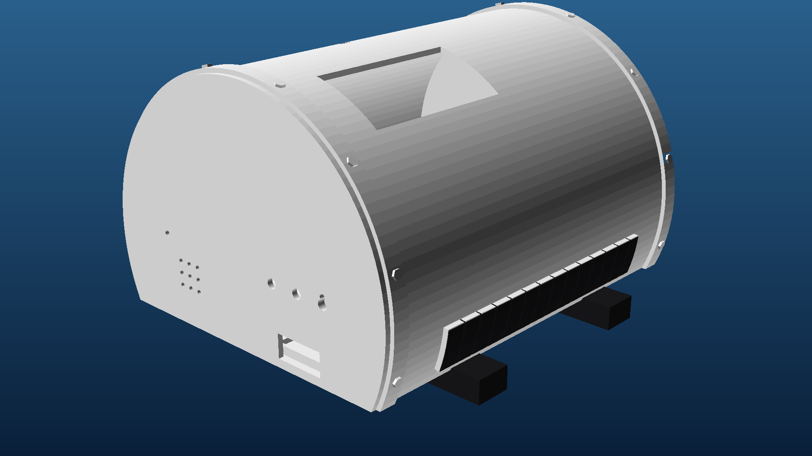<br/><b>Front Enclosure Profile</b></td>
      <td align="center">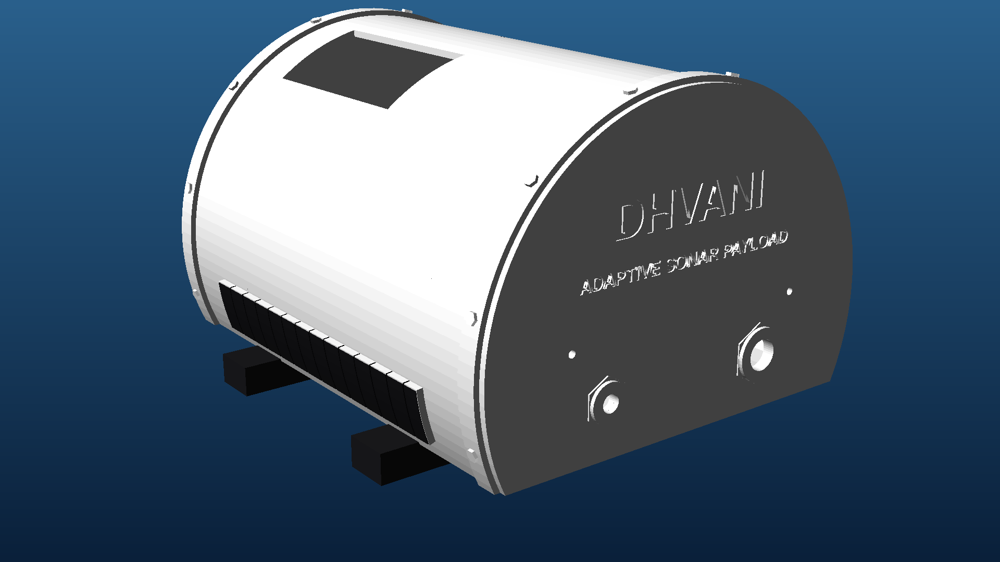<br/><b>Rear Cable Passthrough Ports</b></td>
    </tr>
    <tr>
      <td align="center">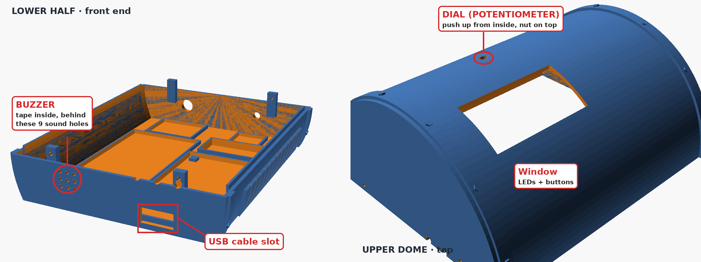<br/><b>Sound Grid & Clarity Dial</b></td>
      <td align="center">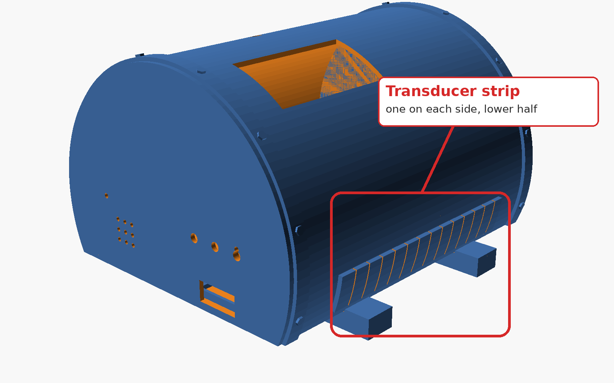<br/><b>Transducer Hull Mounting Strip</b></td>
    </tr>
    <tr>
      <td colspan="2" align="center">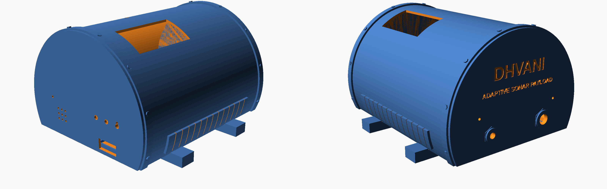<br/><b>Parametric OpenSCAD 3D Enclosure Render (v2)</b></td>
    </tr>
  </table>
</div>

### Mechanical Specifications:
- **Dimensions**: 245 mm length $\times$ 202 mm outer diameter (+ 5 mm hydrodynamic hull rings).
- **Enclosure Structure**:
  - `DHVANI_Pod_lower.stl`: Lower hull cradle with electronics bays and transducer mounting slots.
  - `DHVANI_Pod_upper.stl`: Upper protective dome shell with sound grill openings.
  - `DHVANI_Pod_saddle_PRINT_2.stl`: Dual mounting saddle clamps securing the pod to an AUV tubular frame.
- **Parametric Source**: Developed in **OpenSCAD** (`hardware/pod/DHVANI_Pod_FINAL_v2.scad`).
- **Fasteners**: 4 $\times$ M3 $\times$ 10 mm self-tapping screws.

---

## 15. Repository Structure

```
DHVANI-Software-Defined-Sonar/
│
├── README.md                          # Master project documentation & presentation
├── LICENSE                            # MIT Open-Source License
├── CONTRIBUTING.md                    # Engineering contribution guidelines
├── .gitignore                         # Build artifact and editor ignore rules
│
├── firmware/                          # Complete STM32CubeIDE embedded C project
│   ├── Core/                          # Application source code
│   │   ├── Inc/main.h                 # Master peripheral and pin definitions
│   │   ├── Src/main.c                 # Sonar synthesis engine, DMA stream & sleep logic
│   │   └── Startup/                   # Cortex-M33 assembly startup routines
│   ├── Drivers/                       # STM32U5xx HAL and CMSIS firmware libraries
│   ├── sih.ioc                        # STM32CubeMX graphical hardware configuration
│   ├── STM32U575ZITXQ_FLASH.ld        # Flash memory linker script
│   └── README.md                      # Detailed embedded firmware documentation
│
├── dashboard/                         # Ground-station web console & ML pipeline
│   ├── app.py                         # Streamlit real-time visualization application
│   ├── telemetry.py                   # Serial ASCII telemetry parsing engine
│   ├── capture.py                     # Serial port logging utility
│   ├── requirements.txt               # Python package dependencies
│   ├── dhvani_model.joblib            # Serialized RandomForest classifier
│   ├── dhvani_model_report.txt        # Classification evaluation metrics
│   ├── models/                        # Packaged model storage
│   ├── training/                      # Dataset generation and training scripts
│   ├── sample/                        # Replay logs (log_demo.txt, log_bench_sample.txt)
│   └── README.md                      # Dashboard operational manual
│
├── hardware/                          # CAD models, PCB designs & mechanical drawings
│   ├── pod/                           # 3D-printable PLA payload enclosure
│   │   ├── DHVANI_Pod_FINAL_v2.scad   # Parametric OpenSCAD design source
│   │   ├── *.stl                      # Production-ready stereolithography print meshes
│   │   ├── photos/                    # High-resolution bench photographs of printed pod
│   │   └── README.txt                 # Print settings & slicer parameters
│   ├── pcb/                           # Custom Nucleo-144 shield PCB design brief
│   │   ├── DHVANI_Shield_KiCad_Guide.pdf
│   │   └── DHVANI_Shield_PCB_Design_Brief.pdf
│   └── README.md                      # Mechanical & analog front-end documentation
│
├── diagrams/                          # Vector (SVG) and raster (PNG / 4K) schematics
│   ├── architecture/                  # System blocks & firmware execution flows
│   ├── hardware/                      # Breadboard wiring & pinout diagrams
│   ├── signal-processing/             # Windowing sidelobe & clear-vs-muddy charts
│   └── README.md                      # Diagram index and descriptions
│
├── docs/                              # Engineering PDFs, tech stacks, and testing guides
│   ├── hardware/                      # Builtin DAC build guide & pin roadmap
│   ├── firmware/                      # Technology stack breakdown
│   ├── testing/                       # Complete laboratory test & calibration guide
│   └── README.md                      # Documentation roadmap
│
└── images/                            # Presentation graphics & README photo assets
```

---

## 16. Installation and Setup

### Clone Repository:
```bash
git clone https://github.com/dipeshjanghel/DHVANI-Software-Defined-Sonar.git
cd DHVANI-Software-Defined-Sonar
```

---

## 17. Firmware Build Instructions

### Toolchain Requirements:
- **STM32CubeIDE** (v1.14.0 or newer).
- **ST-LINK/V3** in-circuit programmer/debugger (integrated on the Nucleo board).

### Steps:
1. Open STM32CubeIDE and choose your workspace directory.
2. Select **File > Import... > General > Existing Projects into Workspace**.
3. Set the root directory to `DHVANI-Software-Defined-Sonar/firmware/` and click **Finish**.
4. Connect the NUCLEO-U575ZI-Q board to your workstation via Micro-USB.
5. Click **Project > Build All** (`Ctrl+B`). Verify that the project compiles with 0 errors.
6. Click **Run > Debug** (`F11`) to flash the firmware.

---

## 18. Dashboard Setup

### Prerequisites:
- Python 3.10, 3.11, or 3.12.

### Launch Instructions:
```bash
cd dashboard

# 1. Create and activate virtual environment
python -m venv .venv
# On Windows PowerShell:
.venv\Scripts\Activate.ps1
# On Linux / macOS:
source .venv/bin/activate

# 2. Install dependencies
pip install -r requirements.txt

# 3. Run dashboard in demonstration mode (no hardware required)
streamlit run app.py

# 4. Or connect to live board on virtual COM port (e.g. COM9)
streamlit run app.py -- COM9
```

---

## 19. Testing and Validation

### Laboratory Bench Verification Procedure:
1. **Oscilloscope Setup**:
   - Channel 1 (Yellow): Connect probe to TL074 buffered analog output (47 $\Omega$ test line).
   - Channel 2 (Blue): Connect probe to `PE0` (CPU-Busy line).
2. **Verification of Zero-CPU Sleep**:
   - Trigger the scope on the Channel 1 pulse.
   - Observe Channel 2 (`PE0`): The signal pulls **LOW** for the entire duration of the acoustic transmission and only returns **HIGH** after GPDMA transfer completion, proving the CPU is in `__WFI()` sleep during transmission.
3. **FFT Spectrum Verification**:
   - Enable the digital storage oscilloscope's Math FFT function.
   - For Barker-13 BPSK (Mode 2), verify center carrier peak at **8.7 kHz** (predicted: 8.45 kHz).
   - For LFM Chirp (Mode 0), sweep the clarity dial from muddy to clear and verify bandwidth expands from $2.0 - 5.8\text{ kHz}$ to $2.0 - 17.0\text{ kHz}$.

---

## 20. Technical Limitations & Engineering Honesty

In the interest of rigorous scientific transparency and engineering integrity, the implementation status of each system component is explicitly disclosed below:

```
┌────────────────────────────────────────────────────────────────────────────────────────┐
│                               STATUS CLASSIFICATION MATRIX                             │
│                                                                                        │
│   [ IMPLEMENTED & TESTED ]    [ DEMONSTRATION STAND-IN ]    [ DESIGNED / PLANNED ]     │
│   • STM32U575 Firmware        • Turbidity Potentiometer     • Nucleo-144 Shield PCB    │
│   • GPDMA Zero-CPU Stream     • Synthetic ML Dataset        • Hydrophone Echo Receiver │
│   • TL074 AFE & Butterworth   • 1 kΩ Audio Buzzer           • Seabed Side-Scan Imaging │
│   • DS18B20 & TDS Sensors                                                              │
│   • INA219 Power Monitor                                                               │
└────────────────────────────────────────────────────────────────────────────────────────┘
```

1. **Temperature Measurement**: Fully **IMPLEMENTED & TESTED** using a physical DS18B20 digital 1-Wire sensor on pin `PF12`.
2. **Salinity Measurement**: Fully **IMPLEMENTED & TESTED** using an analog TDS probe sampled by ADC1 on pin `PC3`.
3. **Power & Energy Monitoring**: Fully **IMPLEMENTED & TESTED** using a physical Texas Instruments INA219 sensor over $I^2\text{C}$ on pins `PB8`/`PB9`.
4. **Clarity / Turbidity Input**: **DEMONSTRATION STAND-IN**. During bench testing, commercial optical turbidity sensors exhibited insufficient dynamic contrast in small test beakers. An analog $10\text{ k}\Omega$ potentiometer was integrated on pin `PA3` as an operational scenario dial to simulate turbid water transitions. **No claim of a deployed physical optical turbidity sensor is made.**
5. **Machine Learning Classifier**: **SYNTHETIC TRAINING DATA**. The RandomForest ground-station model was trained and evaluated on synthetic parameter vectors (`dashboard/data/dhvani_synthetic_dataset.csv`). While pipeline mechanics and inference achieve 98.5% metrics, real-world ocean deployment requires collecting empirical tank acoustic logs.
6. **Shield PCB**: **DESIGNED / PLANNED**. The KiCad design brief and schematics in `hardware/pcb/` represent planned engineering hardware. Bench prototypes were validated on protoboards.
7. **Echo Receiver & Imaging**: **FUTURE SCOPE**. DHVANI is currently a transmission payload engine. Echo reception, beamforming, and side-scan seabed image reconstruction are scheduled for subsequent development phases.

---

## 21. Future Roadmap

- [ ] **Physical Optical Turbidity Integration**: Integrate calibrated nephelometric turbidity units (NTU) optical sensor with hardware noise filtering.
- [ ] **Fabrication of Custom Shield PCB**: Fabricate and populate the 4-layer Nucleo-144 expansion shield specified in `hardware/pcb/`.
- [ ] **Hydrophone Echo Receiver Stage**: Develop dual-channel preamplification and high-speed ADC sampling for closed-loop pulse-compression matched filtering.
- [ ] **Empirical Marine Dataset Acquisition**: Deploy the payload in fresh and saltwater test tanks to train the ground-station classifier on genuine hydrophone echoes.
- [ ] **Acoustic Communication (FSK / QPSK)**: Expand the software-defined engine to support bi-directional underwater acoustic communication packet telemetry.

---

## 22. Developer Information

<div align="center">

**Dipesh Janghel**  
*Embedded Systems & Firmware Engineer | Digital Signal Processing | Robotics*

[](https://github.com/dipeshjanghel)
[](https://github.com/dipeshjanghel)
[](https://github.com/dipeshjanghel/DHVANI-Software-Defined-Sonar)

</div>

---

## License

This project is licensed under the **MIT License** — see the [LICENSE](LICENSE) file for complete details.
