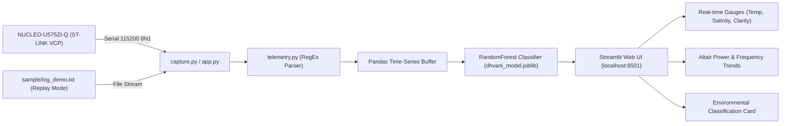

# DHVANI Ground-Station Dashboard & Telemetry Processing

This directory contains the Python ground-station software for the **DHVANI Adaptive Software-Defined Sonar Transmitter**. It provides real-time visualization of acoustic telemetry, telemetry logging, and an integrated environmental classification pipeline.

---

## Technical Architecture



---

## Directory Organization

```
dashboard/
│
├── app.py                     # Main Streamlit web application
├── telemetry.py               # Shared serial telemetry parsing module
├── capture.py                 # Standalone serial logger to capture raw board pings
├── requirements.txt           # Python package dependencies
├── dhvani_model.joblib        # Serialized RandomForest classifier
├── dhvani_model_report.txt    # Precision, recall, and F1-score evaluation report
│
├── models/                    # Packaged model artifact repository
│   ├── dhvani_model.joblib
│   └── dhvani_model_report.txt
│
├── training/                  # Model training and dataset generation pipeline
│   ├── generate_dataset.py    # Generates synthetic multi-condition environmental dataset
│   ├── train.py               # Fits RandomForestClassifier with Scikit-Learn
│   ├── evaluate.py            # Generates classification metrics and confusion matrices
│   └── generate_demo_log.py   # Synthesizes telemetry streams for automated demonstrations
│
├── data/                      # Training dataset storage
│   └── dhvani_synthetic_dataset.csv
│
├── sample/                    # Pre-recorded test telemetry
│   ├── log_demo.txt           # Synthetic demonstration telemetry cycling all water conditions
│   └── log_bench_sample.txt   # Verified raw telemetry captured from STM32 hardware bench
│
├── docs/                      # Architectural and operational documentation
│   ├── DHVANI_Dashboard_Guide.pdf
│   ├── DHVANI_ML_Model_Guide.pdf
│   └── DHVANI_ML_Where_It_Goes.pdf
│
└── .streamlit/
    └── config.toml            # Custom dark oceanic visual theme
```

---

## Installation & Setup

### 1. Environment Preparation

Ensure Python 3.10 or newer is installed:

```bash
cd dashboard
python -m venv .venv
# Windows PowerShell:
.venv\Scripts\Activate.ps1
# Linux/macOS:
source .venv/bin/activate

pip install -r requirements.txt
```

### 2. Running the Dashboard

#### Demonstration / Offline Mode (No hardware required)
Replays `sample/log_demo.txt` in a continuous loop:
```bash
streamlit run app.py
```

#### Replaying Bench Sample Telemetry
Replays verified bench telemetry captured directly from the STM32 board:
```bash
streamlit run app.py -- replay:sample/log_bench_sample.txt
```

#### Live Hardware Telemetry
Connect the NUCLEO-U575ZI-Q via USB and specify the virtual COM port (e.g., `COM9` on Windows or `/dev/ttyACM0` on Linux):
```bash
streamlit run app.py -- COM9
```
*(Ensure any open serial monitor, PuTTY session, or STM32CubeIDE console is closed before running).*

The dashboard launches automatically in your browser at `http://localhost:8501`.

---

## Telemetry Parser Specification

The parser (`telemetry.py`) processes ASCII lines formatted as:

```
AUD-LFM T=25.2C c=1502 clarity=3850 (clear=3900) tds=450ppm f=2000-16850Hz dur=4ms amp=1290 | I=12.15mA E=0.8mJ batt=94% NORMAL
```

Extracted fields:
- `mode`: Modulation identifier (`AUD-LFM`, `AUD-GEO`, `AUD-BPSK`, `US-LFM`, `US-GEO`, `US-BPSK`).
- `temp_c`: Temperature in Celsius ($T$).
- `c_mps`: Speed of sound in meters per second ($c$).
- `clarity`: Turbidity ADC reading (0–4095).
- `tds_ppm`: Salinity in parts per million.
- `f_lo_hz` / `f_hi_hz`: Bandwidth bounds ($f_0$, $f_1$).
- `duration_ms`: Active pulse duration ($T$).
- `amp_dac`: Peak DAC amplitude counts ($0 - 2047$).
- `current_ma`: Instantaneous payload current ($I_{\text{mA}}$).
- `energy_mj`: Energy consumed per ping ($E_{\text{mJ}}$).
- `battery_pct`: Battery reserve percentage ($\%$) based on mission budget.
- `power_mode`: State indicator (`NORMAL`, `ECONOMY`, `SURVIVE`).

---

## Machine Learning Pipeline & Technical Honesty

### Model Overview
The classifier (`RandomForestClassifier`) uses three environmental inputs to predict the water regime:
$$\text{Inputs: } [\text{temp\_c},\ \text{tds\_ppm},\ \text{clarity}] \longrightarrow \text{Output: Condition Label}$$

Classes:
1. `clear_fresh`: High clarity, low TDS, moderate temperature.
2. `clear_reef`: High clarity, high TDS, warm temperature.
3. `muddy_river`: Low clarity, low TDS, variable temperature.
4. `muddy_estuary`: Low clarity, intermediate TDS, variable temperature.

### Crucial Technical Disclosure
> [!IMPORTANT]
> **Synthetic Dataset Notice**: The current model (`dhvani_model.joblib`) is trained and evaluated strictly on **synthetic training data** generated via `training/generate_dataset.py`.
>
> While the classification pipeline achieves **98.5% precision/recall** on the synthetic test set (`dhvani_model_report.txt`), this figure validates the software architecture and ML integration, **not real-world oceanographic accuracy**. In accordance with strict engineering honesty, field-grade acoustic classification will require training on hydrodynamic water-tank and marine datasets.
>
> Furthermore, clarity input is obtained using an on-board **potentiometer serving as an analog turbidity stand-in**, as disclosed across all project materials.

---

## Retraining and Evaluation

To regenerate synthetic training data and retrain the classifier:

```bash
# 1. Generate new synthetic dataset
python training/generate_dataset.py

# 2. Train the Random Forest model
python training/train.py

# 3. Evaluate model performance metrics
python training/evaluate.py
```
Evaluation metrics are updated in `dhvani_model_report.txt` and `models/dhvani_model_report.txt`.

---

## Telemetry Logging Utility

To capture real ping sessions from the STM32 board to a text file for subsequent replay:

```bash
python capture.py COM9 session_log.txt
```
Press `Ctrl+C` to terminate capture. The resulting log can be replayed in `app.py` at any time.
