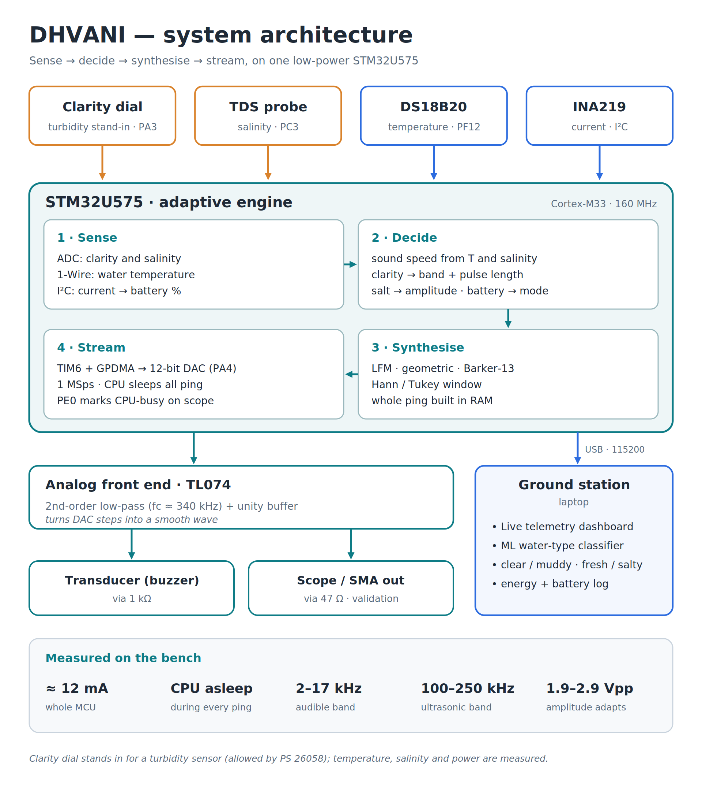
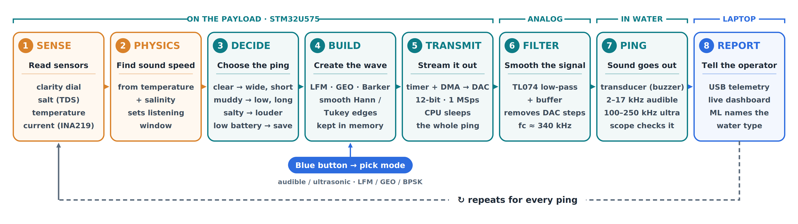
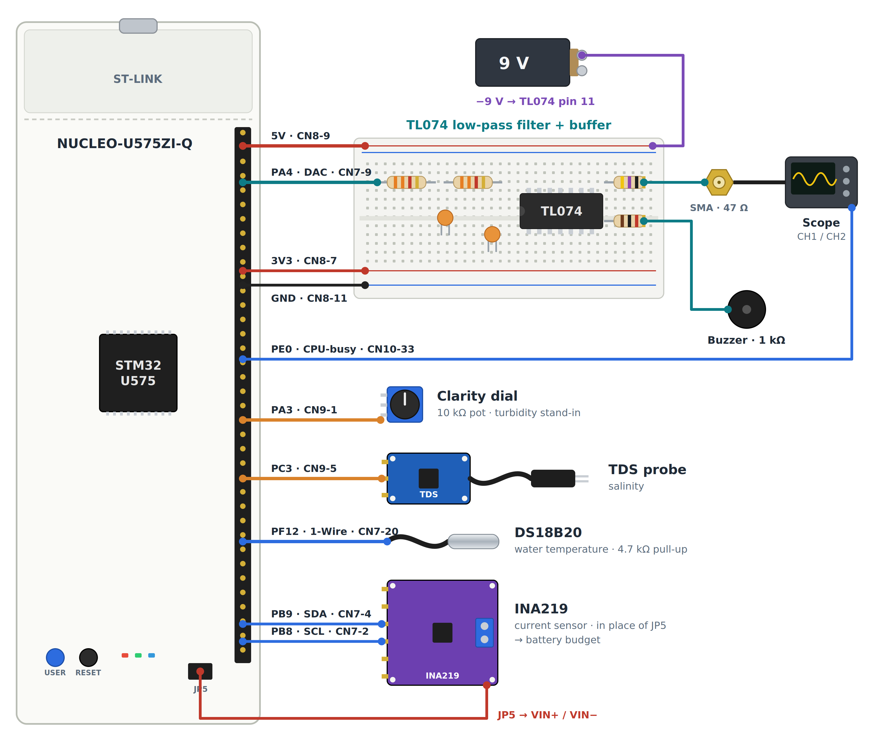
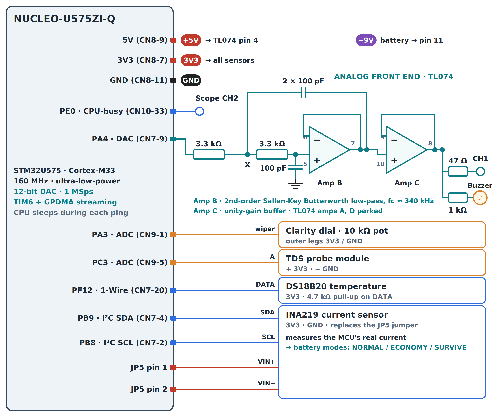
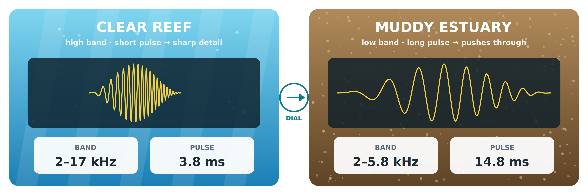
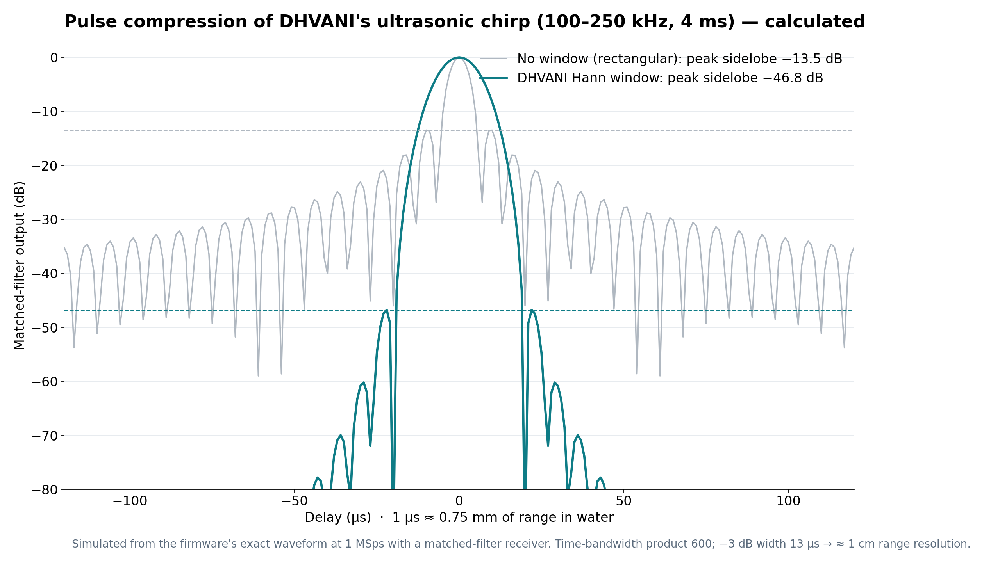

# DHVANI Engineering Diagrams & Visual Schematics

This directory contains high-resolution vector (SVG) and raster (PNG / 4K) diagrams illustrating the architecture, circuit schematics, hardware wiring, signal modulation profiles, and process flows of the **DHVANI Adaptive Software-Defined Sonar Transmitter**.

---

## Diagram Categorization

### 1. System Architecture (`diagrams/architecture/`)
- **`DHVANI_Architecture_HalfSlide.png` / `.svg`**: Comprehensive system overview depicting environmental sensor inputs, STM32U575 processing core, zero-CPU DMA streaming pipeline, TL074 analog front-end, acoustic transducer, and ground-station dashboard telemetry.
- **`DHVANI_Process_Flow.png` / `.svg`**: Complete firmware decision lifecycle showing the execution sequence from sensor sampling and parameter adaptation to low-power DMA transmission and listening windows.
- **`DHVANI_Process_Flow_Designed.pdf` / `DHVANI_Process_Flow_Minimal.pdf`**: Presentation-ready process flow renderings for technical slides and reports.

  
    
  

### 2. Hardware Wiring & Pinout Schematics (`diagrams/hardware/`)
- **`DHVANI_Hardware_Wiring.png` / `.svg`**: Full breadboard and protoboard wiring diagram illustrating exact physical connections between the NUCLEO-U575ZI-Q, TL074 op-amp, DS18B20 temperature probe, TDS sensor, clarity potentiometer, and INA219 power monitor.
- **`DHVANI_Connections.png` / `DHVANI_Connections_16x9_4K.png`**: High-resolution interconnect diagram showing signal paths, power supply rails (+5 V, -9 V), and oscilloscope test points.
- **`DHVANI_Pin_Connections.png` / `DHVANI_Pin_Connections_Bold.png` / `DHVANI_Pin_Connections_HalfSlide.png`**: Morphological pinout cheat sheets optimized for quick bench debugging and laboratory testing.

  
    
  

### 3. Digital Signal Processing & Acoustics (`diagrams/signal-processing/`)
- **`DHVANI_Clear_vs_Muddy.png` / `.svg`**: Side-by-side comparative analysis of chirp bandwidth, pulse duration, and amplitude scaling under simulated clear water versus turbid/muddy water regimes.
- **`DHVANI_Sidelobes_Calculated_16x9.png`**: Analytical spectral representation illustrating the sidelobe suppression achieved by applying Hann and Tukey windowing functions to LFM and Barker-13 BPSK waveforms.

  
    
  

