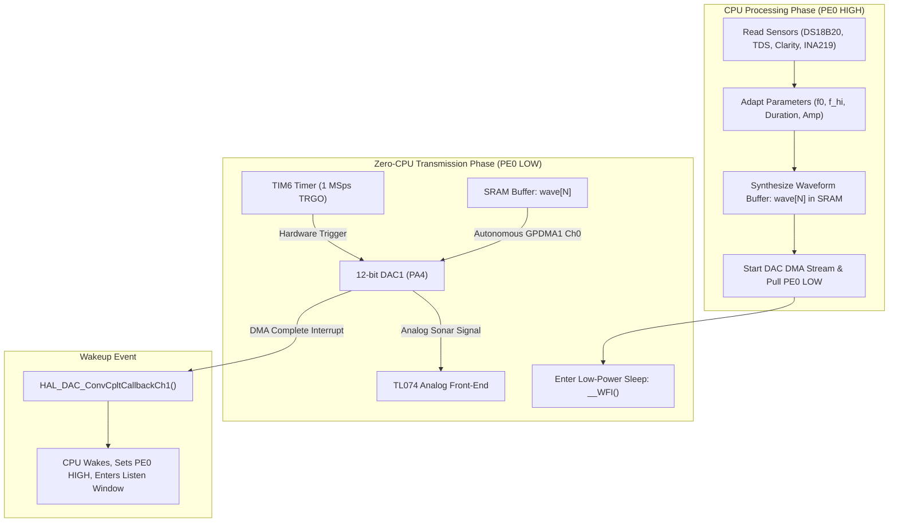

# DHVANI Firmware: STM32U575 Real-Time Sonar Engine

This directory contains the complete **STM32CubeIDE** embedded C firmware project for the **DHVANI Adaptive Software-Defined Sonar Transmitter** running on the **NUCLEO-U575ZI-Q** development board.

---

## Technical Specifications

| Peripheral / Subsystem | Configuration | Hardware Pin | Description |
|---|---|---|---|
| **MCU Core** | ARM Cortex-M33 @ 160 MHz | Internal | Ultra-low-power STM32U575ZIT6Q with FPU & ICACHE |
| **DAC Output** | 12-bit DAC1 Channel 1 | `PA4` | Mid-scale parked at 2048, 1 MSps conversion rate |
| **Hardware Trigger** | TIM6 Base Timer | Internal (TRGO) | Prescaler = 0, ARR = 159 $\rightarrow$ $160\text{ MHz} / 160 = 1.0\text{ MSps}$ |
| **DMA Controller** | GPDMA1 Channel 0 | Internal | Autonomous memory-to-peripheral streaming from `wave[N]` |
| **CPU Busy Probe** | GPIO Output (Speed: Very High) | `PE0` | Oscilloscope probe signal: HIGH when CPU works, LOW during sleep |
| **User Push Button** | EXTI Interrupt | `PC13` (USER PB) | Blue button cycles through the 6 transmission modes |
| **Status LEDs** | GPIO Outputs | `PB0` (Green), `PB7` (Blue), `PG2` (Red) | Green = ping active, Blue = ultrasonic band, Red = ping timeout |
| **Temperature Sensor** | 1-Wire protocol (DWT timed) | `PF12` | DS18B20 probe (4.7 k$\Omega$ external pull-up) |
| **Salinity / TDS** | ADC1 Channel 4 | `PC3` | Analog TDS sensor sampled via 12-bit single-ended ADC |
| **Clarity Stand-in** | ADC1 Channel 15 | `PA3` | 10 k$\Omega$ potentiometer simulating turbidity conditions |
| **Current / Energy Monitor** | I2C1 (100 kHz Standard) | `PB9` (SDA), `PB8` (SCL) | INA219 power monitor ($R_{\text{shunt}} = 0.1\ \Omega$, addr `0x40`) |
| **Telemetry Output** | USART1 / ST-LINK VCP | `PA9` (TX), `PA10` (RX) | 115200 baud, 8 data bits, no parity, 1 stop bit (8N1) |

---

## Architectural Principle: Zero-CPU DMA Streaming

A fundamental design constraint of underwater acoustic transmitters on Autonomous Underwater Vehicles (AUVs) is **power efficiency**. High CPU utilization during continuous signal synthesis wastes limited battery capacity.

DHVANI achieves near-zero CPU power dissipation during waveform transmission through hardware decoupling:



1. **Parameter Adaptation**: The CPU reads environmental sensors and remaining battery budget, then calculates pulse duration, frequency sweep parameters, and amplitude scaling.
2. **Buffer Synthesis**: Samples are pre-computed into static SRAM array `wave[N]` ($N \le 16000$ samples, max 16 ms at 1 MSps).
3. **Transmission Hand-off**: `fire_ping(n)` initiates `HAL_DAC_Start_DMA(&hdac1, DAC_CHANNEL_1, wave, n, DAC_ALIGN_12B_R)`.
4. **Autonomous Streaming**: The CPU immediately pulls `PE0` LOW and enters low-power sleep via `__WFI()`. TIM6 generates update events every $1\ \mu\text{s}$ (1 MSps), triggering GPDMA1 to feed DAC data holding registers directly from RAM.
5. **Wakeup on Completion**: Upon transfer completion, the GPDMA raises an interrupt triggering `HAL_DAC_ConvCpltCallbackCh1()`, waking the core to manage the acoustic listening window.

---

## Signal Modulation Mathematics

The firmware generates three distinct modulations across two acoustic bands (6 operating modes):

### 1. Linear Frequency Modulated (LFM) Chirp
The instantaneous frequency sweeps linearly from $f_0$ to $f_1$ over pulse length $T$:
$$s_{\text{LFM}}(t) = \sin\left(2\pi \left(f_0 t + \frac{f_1 - f_0}{2T} t^2\right)\right)$$
- **Windowing**: Multiplied by a **Hann window** $w(i) = 0.5 \left(1 - \cos\left(\frac{2\pi i}{N-1}\right)\right)$ to eliminate transient discontinuities at pulse boundaries, suppressing spectral sidelobes and out-of-band emissions.

### 2. Geometric Chirp Sweep
The frequency increases exponentially such that the ratio of frequency to instantaneous bandwidth remains constant:
$$s_{\text{GEO}}(t) = \sin\left(2\pi \frac{f_0 T}{\ln(f_1 / f_0)} \left(e^{\frac{t \ln(f_1 / f_0)}{T}} - 1\right)\right)$$
- **Windowing**: Multiplied by a **Hann window** for matched filtering sidelobe reduction.

### 3. Barker-13 Phase-Coded BPSK
The carrier frequency $f_c = \frac{f_0 + f_1}{2}$ undergoes discrete 180° phase shifts according to the optimal 13-element Barker sequence:
$$\mathbf{B} = [+1, +1, +1, +1, +1, -1, -1, +1, +1, -1, +1, -1, +1]$$
$$s_{\text{BPSK}}(t) = \mathbf{B}\left[\left\lfloor \frac{13 \cdot i}{N} \right\rfloor\right] \cdot \sin(2\pi f_c t)$$
- **Windowing**: Multiplied by a **Tukey window** (cosine-tapered window with $\alpha = 0.2$). The 10% cosine taper on each edge prevents high-frequency switching transients from exceeding the slew rate of the TL074 operational amplifier, while preserving a constant flat-top carrier amplitude across the chip sequence.

---

## Adaptive Parameter Selection Engine

Environmental inputs dynamically shape the transmitted ping parameters:

```
Water Clarity (Potentiometer Stand-in: T_MUDDY=200, T_CLEAR=3900)
    │
    ├──> Normalized Clarity: t_norm = (t_avg - T_MUDDY) / (T_CLEAR - T_MUDDY)
    │
    ├──> Sweep Bandwidth:
    │       Audible:     f0 = 2 kHz,     f_hi = 5 kHz + (t_norm * 12 kHz)     [2–17 kHz]
    │       Ultrasonic:  f0 = 100 kHz,   f_hi = 120 kHz + (t_norm * 130 kHz)  [100–250 kHz]
    │
    ├──> Pulse Duration: dur_ms = (4.0 ms + (1.0 - t_norm) * 12.0 ms) * dur_scale
    │       Clear water -> Short 4 ms pulse (high range resolution)
    │       Muddy water -> Long 16 ms pulse (higher energy for turbid penetration)

Salinity (TDS Sensor raw PC3 -> ppm):
    │
    ├──> Amplitude: amp = (1200 + d_avg * 0.2) * amp_scale  (clamped at 1800 counts)
            Fresh water -> ~1.90 Vpp (low attenuation)
            Saline water -> ~2.92 Vpp (overcomes ionic conductivity acoustic losses)

Speed of Sound (Mackenzie-derived empirical acoustic formula):
    c = 1449.2 + 4.6·T - 0.055·T² + 0.00029·T³ + (1.34 - 0.01·T)·(S - 35)
    Listen Window = (2 * R_MAX / c) * factor
```

---

## Battery Budget Energy Management

The on-board INA219 power monitor measures current ($I_{\text{mA}}$) and bus voltage ($V_{\text{bus}}$). The firmware tracks accumulated milliampere-hours ($\text{mAh}$) against a predefined mission budget ($\text{BUDGET}_{\text{mAh}} = 2.0\ \text{mAh}$):

$$\text{remain} = 1.0 - \frac{\text{used\_mAh}}{\text{BUDGET\_mAh}}$$

| Battery State | Remaining Budget | Amplitude Scale | Duration Scale | Ping Duty Cycle Factor | Operating State |
|---|---|---|---|---|---|
| **High** | $\text{remain} > 50\%$ | $1.0\times$ | $1.0\times$ | $1.0\times$ (nominal) | `NORMAL` |
| **Medium** | $20\% \le \text{remain} \le 50\%$ | $0.8\times$ | $0.75\times$ | $2.0\times$ (half ping rate) | `ECONOMY` |
| **Critical** | $\text{remain} < 20\%$ | $0.6\times$ | $0.5\times$ | $4.0\times$ (quarter ping rate) | `SURVIVE` |

---

## Serial Telemetry Output Specification

The firmware outputs ASCII telemetry via USART1/ST-LINK VCP at **115200 baud (8N1)** immediately following each transmission:

```
AUD-LFM T=25.2C c=1502 clarity=3850 (clear=3900) tds=450ppm f=2000-16850Hz dur=4ms amp=1290 | I=12.15mA E=0.8mJ batt=94% NORMAL
```

### Telemetry Field Breakdown:
- `AUD-LFM`: Transmission band (`AUD` or `US`) and modulation scheme (`LFM`, `GEO`, or `BPSK`).
- `T=25.2C`: Water temperature measured by DS18B20 (°C).
- `c=1502`: Calculated speed of sound in water ($m/s$).
- `clarity=3850 (clear=3900)`: Current turbidity raw ADC reading and reference threshold.
- `tds=450ppm`: Salinity / Total Dissolved Solids in parts per million.
- `f=2000-16850Hz`: Sweep start frequency ($f_0$) and stop frequency ($f_1$).
- `dur=4ms`: Active acoustic pulse duration.
- `amp=1290`: 12-bit DAC peak amplitude counts ($V_{pp} = 2 \cdot \text{amp} \cdot \frac{3.3}{4095}$).
- `I=12.15mA`: Measured active payload current.
- `E=0.8mJ`: Energy consumed by the last ping cycle.
- `batt=94%`: Remaining battery budget percentage.
- `NORMAL`: Adaptive power mode (`NORMAL`, `ECONOMY`, `SURVIVE`).

---

## Build & Flash Instructions

### Prerequisites
1. **STM32CubeIDE** (version 1.14.0 or newer).
2. **NUCLEO-U575ZI-Q** board connected via Micro-USB to the ST-LINK port.

### Compiling and Flashing
1. Launch STM32CubeIDE.
2. Select **File > Open Projects from File System...** and navigate to this `firmware/` directory.
3. Select the project and click **Finish**.
4. Right-click the project root and select **Build Project** (or press `Ctrl+B`).
5. Run or debug via **Run > Run As > STM32 Cortex-M C/C++ Application**.
6. The ST-LINK programmer flashes `STM32U575ZITXQ_FLASH.ld` to the target microcontroller.
