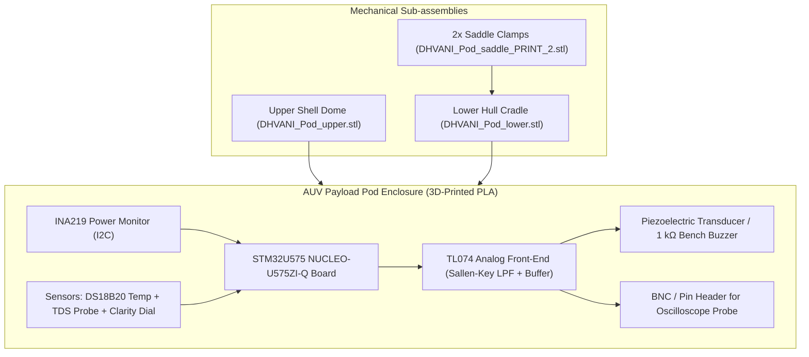
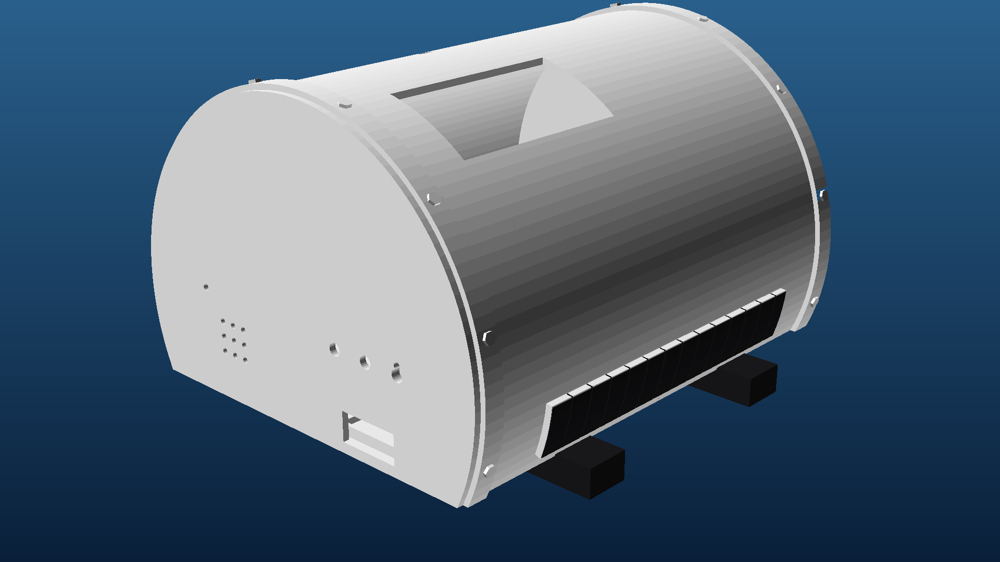
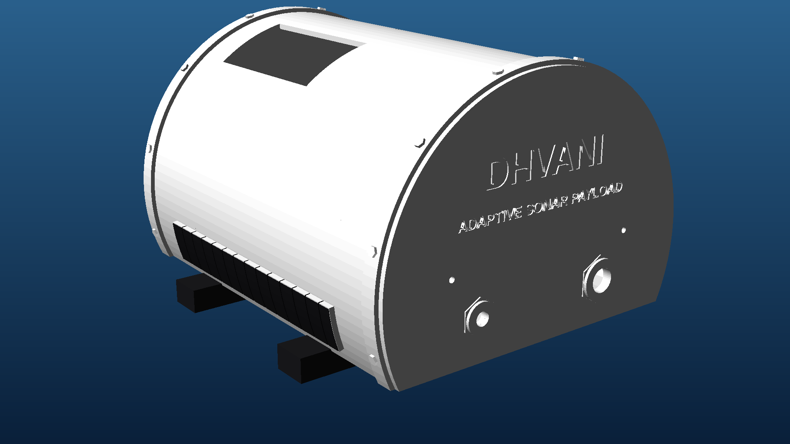
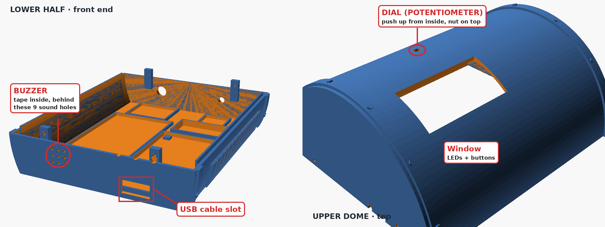
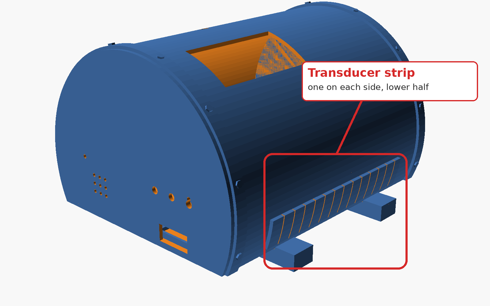
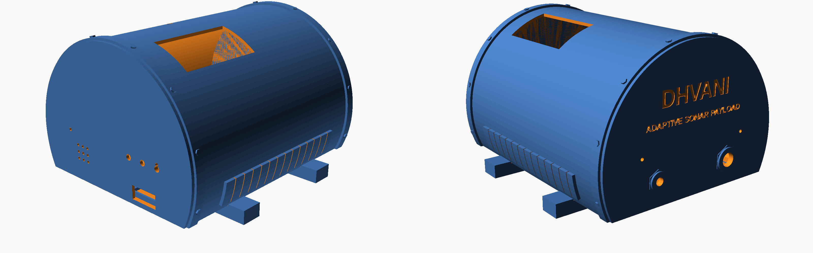

# DHVANI Hardware & Mechanical Architecture

This directory contains the complete mechanical design, 3D-printable enclosure assets, analog front-end documentation, and custom PCB roadmap for the **DHVANI Adaptive Software-Defined Sonar Transmitter**.

---

## Hardware System Overview



---

## Directory Organization

```
hardware/
│
├── pod/                                       # 3D Mechanical CAD and additive manufacturing files
│   ├── DHVANI_Pod_FINAL_v2.scad               # Parametric OpenSCAD design source (v2 geometry)
│   ├── DHVANI_Pod_FINAL_v3_colour.scad        # Multi-material colored OpenSCAD rendering model
│   ├── DHVANI_Pod_lower.stl                   # Print-ready lower hull section
│   ├── DHVANI_Pod_upper.stl                   # Print-ready upper dome enclosure
│   ├── DHVANI_Pod_saddle_PRINT_2.stl          # Print-ready saddle mounting bracket (print 2 copies)
│   ├── DHVANI_Pod_assembled_VIEW_ONLY.stl      # Complete assembled pod (CAD visualization only)
│   ├── DHVANI_Pod_Measurement_Guide.pdf       # Dimensioned mechanical drawing & clearance specs
│   ├── DHVANI_Pod_Printing_Instructions.pdf   # Slicer profiles, orientation, and infill guide
│   ├── DHVANI_Pod_v2_preview.png              # CAD isometric render preview
│   ├── README.txt                             # Rapid fabrication settings reference
│   └── photos/                                # Physical bench photographs
│       ├── DHVANI_Pod_white_front.png         # Front profile of printed pod
│       ├── DHVANI_Pod_white_rear.png          # Rear profile showing cable passthrough ports
│       ├── DHVANI_Pod_buzzer_and_dial.png     # Interior view showing sound-hole grid and dial
│       └── DHVANI_Pod_transducer_strip.png    # Underside transducer mounting strip
│
└── pcb/                                       # Custom Nucleo-144 shield design files
    ├── DHVANI_Shield_PCB_Design_Brief.pdf     # Engineering electrical schematic & routing requirements
    └── DHVANI_Shield_KiCad_Guide.pdf          # Step-by-step layout guide for KiCad 8.0
```

---

## 1. 3D-Printed Payload Pod (`hardware/pod/`)

The payload pod is engineered as an AUV-mountable, low-drag external instrument housing designed for rapid prototyping in standard PLA filament.

<div align="center">
  <table>
    <tr>
      <td align="center"><br/><b>Front Enclosure Profile</b></td>
      <td align="center"><br/><b>Rear Cable Passthrough Ports</b></td>
    </tr>
    <tr>
      <td align="center"><br/><b>Internal Sound Grid & Clarity Dial</b></td>
      <td align="center"><br/><b>Transducer Hull Mounting Strip</b></td>
    </tr>
    <tr>
      <td colspan="2" align="center"><br/><b>Parametric OpenSCAD 3D Enclosure Render (v2)</b></td>
    </tr>
  </table>
</div>

### Dimensions & Specifications
- **Total Length**: 245 mm (+ 2.5 mm connector collars on end caps).
- **Diameter**: 202 mm (+ 5 mm outer hydrodynamic hull rings).
- **Internal Envelope**: Accommodates standard NUCLEO-144 form factor, analog front-end breadboard/protoboard, sensor wire harness, and dual battery clips.
- **Fasteners**: 4 $\times$ M3 $\times$ 10 mm self-tapping screws securing the upper dome to the lower hull cradle.

### 3D Printing Instructions (FDM / Cura / PrusaSlicer)
| Part File | Quantity | Orientation | Supports | Slicer Parameters |
|---|---|---|---|---|
| `DHVANI_Pod_lower.stl` | 1 | Flat underside down | Tree supports, build-plate only | 0.20 mm layer height, 3 perimeters, 15% gyroid/grid infill |
| `DHVANI_Pod_upper.stl` | 1 | Cut face down on bed | Tree supports enabled inside dome | 0.20 mm layer height, 3 perimeters, 15% infill |
| `DHVANI_Pod_saddle_PRINT_2.stl` | 2 | Flat side down | **No supports required** | 0.20 mm layer height, 4 perimeters, 25% infill (structural) |
| `DHVANI_Pod_assembled_VIEW_ONLY.stl` | — | **DO NOT PRINT** (CAD inspection only) | — | — |

---

## 2. Analog Front-End (AFE) Signal Conditioning

Because direct DAC output cannot drive complex inductive or capacitive underwater acoustic transducers, the DAC signal ($PA4$) undergoes active signal conditioning before reaching the output stage.

### Circuit Topology:
1. **Low-Pass Reconstruction Filter**:
   - Operational Amplifier: **TL074** (low-noise JFET-input quad op-amp).
   - Topology: Second-order Sallen-Key Butterworth Low-Pass Filter.
   - Designed Cutoff Frequency ($f_c$): $\approx 340\text{ kHz}$.
   - Attenuation: $-40\text{ dB/decade}$ roll-off to suppress DAC staircase quantization noise and mirror sampling images above the 1 MSps Nyquist frequency.
2. **Buffer Stage**:
   - Unity-gain non-inverting buffer stage providing low output impedance.
3. **Power Rails**:
   - Operational power: $+5\text{ V}$ and $-9\text{ V}$ (supplied via 9 V battery rail) to support bipolar signal excursions without clipping.
4. **Output Terminations**:
   - $47\ \Omega$ series resistor feeding the BNC oscilloscope probe connection for impedance matching.
   - $1\text{ k}\Omega$ series resistor driving the audible acoustic test buzzer.

---

## 3. Custom Shield PCB Roadmap (`hardware/pcb/`)

> [!IMPORTANT]
> **Technical Honesty Disclosure**:
> The custom Nucleo-144 shield PCB is currently in the **engineering design phase**. Comprehensive design documents, KiCad layer stackup guidelines, and schematic briefs are included in `hardware/pcb/`, but the physical bench prototypes were validated using protoboard circuits. Custom PCB fabrication is scheduled for future deployment.

### PCB Design Brief Summary:
- **Form Factor**: Stackable Arduino Uno / Nucleo-144 expansion shield.
- **Layers**: 4-layer FR4 stackup (Signal - GND Plane - Power Plane - Signal).
- **Integrated Subsystems**:
  - On-board high-speed dual-rail op-amp stage.
  - Dedicated screw terminal blocks for 1-Wire DS18B20, analog TDS salinity probe, and turbidity inputs.
  - Surface-mount INA219 current sensor with Kelvin-sense shunt traces.
  - Transducer drive transformer footprint for high-voltage ultrasonic excitation.
